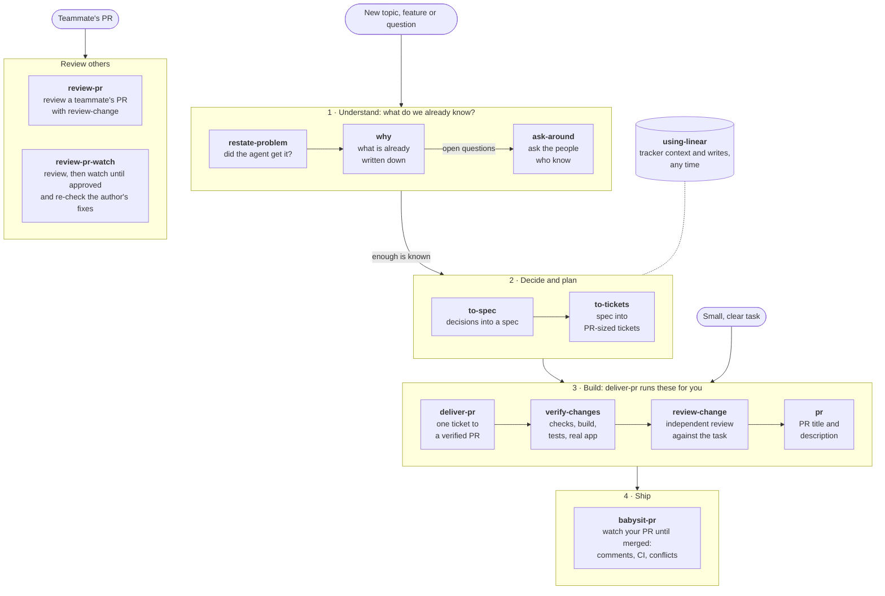

# Skills for Software Engineers

Agent skills by [@k0siara](https://github.com/k0siara). They cover one path: from a fuzzy topic to a merged PR, plus reviewing other people's PRs.

## Install

```bash
npx skills@latest add k0siara/skills
```

Then run the `setup-k0siara-skills` skill once (`/setup-k0siara-skills`). It asks which model reviews and verifies, and creates the `review` agent that `deliver-pr`, `review-change` and `review-pr` run their verification and review subagents in, for each harness it finds: OMP, Codex and Claude Code. The agent has no instructions of its own; each skill passes the full prompt. In OMP it runs on the model you choose; in Codex and Claude Code it uses the session's model. Without the setup these skills fall back to plain subagents.

The skills take company-specific rules (tracker, Git, review conventions) from your workspace instructions (`AGENTS.md`, `CLAUDE.md` and the files they point to), so they carry no project knowledge themselves.

## The workflow



Go top to bottom. Skip a stage when you already have its output: a small, clear task goes straight to `deliver-pr`. Inside **Build**, `deliver-pr` runs `verify-changes`, `review-change` and `pr` for you; run them by hand when you build without it.

## Which skill, when and why

| Stage | Skill | Use it when | Why |
|---|---|---|---|
| Setup | [setup-k0siara-skills](./skills/setup-k0siara-skills/SKILL.md) | Once after installing, and to change the review model | Creates the `review` agent the review and verification steps run in |
| 1 · Understand | [restate-problem](./skills/restate-problem/SKILL.md) | Before non-trivial work | Catches a misunderstanding before it costs a spec |
| | [why](./skills/why/SKILL.md) | "What did we decide about X?", "How is X supposed to work?" | Answers from the tracker, docs, PRs and notes with sources instead of guesses, and lists what is still unknown and who knows |
| | [ask-around](./skills/ask-around/SKILL.md) | The record does not answer something | Turns open questions into short messages per person, then folds the answers back in |
| 2 · Decide and plan | [to-spec](./skills/to-spec/SKILL.md) | The topic is discussed and needs a spec, PRD or RFC | Settles the last decisions in one round and writes a spec another agent can implement from |
| | [to-tickets](./skills/to-tickets/SKILL.md) | A spec is approved | Cuts it into self-contained one-PR tickets (parent + child = the full brief, checked by a blind read), with blocking edges, published to your tracker |
| 3 · Build | [deliver-pr](./skills/deliver-pr/SKILL.md) | A ticket or a small, clear task is ready | Takes it end to end in an isolated worktree: plan, code, verification, independent review, PR |
| | [verify-changes](./skills/verify-changes/SKILL.md) | Before a commit, PR or merge | Proves the change with the repo's own checks and the real app, with evidence |
| | [review-change](./skills/review-change/SKILL.md) | A branch is done and needs a second pair of eyes | Reviews it against its task with reviewers who did not write it |
| | [pr](./skills/pr/SKILL.md) | Opening or updating a PR | Writes a description grounded in the diff and the verification that ran |
| 4 · Ship | [babysit-pr](./skills/babysit-pr/SKILL.md) | Your PR is open | Watches it until it merges, rebases on conflict also after approval, fixes routine CI failures itself, proposes fixes and replies to comments |
| Review others | [review-pr](./skills/review-pr/SKILL.md) | A teammate asks for a review | Reviews in a detached worktree and publishes only the comments you approve |
| | [review-pr-watch](./skills/review-pr-watch/SKILL.md) | You reviewed a PR and want to follow it until you approve | Re-checks the author's fixes and replies in code, drafts replies for your approval, and watches the PR in the background until it merges or closes |
| Any time | [using-linear](./skills/using-linear/SKILL.md) | Anything about Linear issues, cycles or backlog | Derives team, project and parent from your current work and asks before every write |

Each skill's `SKILL.md` has the full behavior, requirements and triggers.
